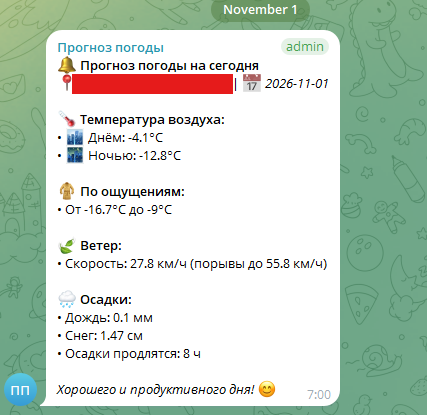
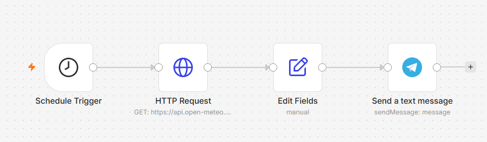

# 🌤️ Ежедневный прогноз погоды в Telegram (Сценарий n8n)

Автоматизированный сценарий для n8n, который ежедневно по расписанию запрашивает актуальный метеорологический прогноз через открытый API Open-Meteo и отправляет форматированную HTML-сводку в Telegram-чат или личные сообщения. Решение полностью автономно, не требует платных подписок и исключает необходимость ручного мониторинга погодных агрегаторов.

## 🚀 Ключевые возможности (Features)

* **Регламентный запуск**: Автоматический триггер по расписанию (Schedule Trigger) каждое утро в заданный час.
* **Работа без платных API-токенов**: Использование бесплатного открытого API Open-Meteo без лимитов авторизации и необходимости выпуска платных ключей.
* **Строгая нормализация и типизация**: Узел Edit Fields (Set) преобразует сырой массив ответа API в строгие типизированные ключи (`number`, `string`) для максимальной надежности при дальнейшей интерполяции.
* **Богатая информационная модель**: Расчет и отображение дневных и ночных экстремумов температур, диапазона ощущаемой температуры, скорости ветра, порывов, а также раздельных показателей дождя, снегопада и суммарных часов осадков.
* **Чистый UI в Telegram**: Генерация структурированного сообщения с поддержкой HTML-разметки и эмодзи-индикаторов.



## 🛠️ Архитектура и стек (Tech Stack)

* **n8n** (Self-hosted / Cloud) — оркестрация сценария, тайминг выполнения, обработка потоков данных.
* **Open-Meteo API** — внешний REST API поставщика метеорологических данных.
* **Telegram Bot API** — доставка сгенерированного отчета конечному пользователю.
  


### Структура нод в сценарии:
1. `Schedule Trigger` — инициализация запуска цепочки по расписанию.
2. `HTTP Request` — выполнение GET-запроса к конечной точке `api.open-meteo.com` с передачей геокоординат и перечня погодных метрик.
3. `Edit Fields` — извлечение первого элемента массивов суточных показателей (`$json.daily.*[0]`) и маппинг в структурированные переменные.
4. `Send a text message` — подстановка переменных в HTML-шаблон и отправка через Telegram-бота.

## 📦 Быстрый старт и установка (Getting Started)

### Предварительные требования (Prerequisites)
* Экземпляр **n8n** (self-hosted версия на Docker/VDS или n8n Cloud).
* Токен бота Telegram (получается через [@BotFather](https://t.me/BotFather)).
* Ваш `Chat ID` или ID канала/группы (можно узнать через [@userinfobot](https://t.me/userinfobot) или методы Telegram API).
* Координаты населенного пункта (широта `latitude` и долгота `longitude`).

### Пошаговое развертывание

1. **Импорт сценария**:
   * Скачайте готовый файл с json схемой `Weather_Forecast_json.json`.
   * В веб-интерфейсе n8n нажмите **Workflows** -> **Import from File / Clipboard** и выберите данный файл.

2. **Настройка геоданных (HTTP Request)**:
   * Откройте ноду `HTTP Request`.
   * Зайдите на сайт https://open-meteo.com/. Выберите нужный регион для прогноза погоды, а также какие конкретно данные погоды вы хотите получать в сводке (в случае, если нужных вам параметров нет в готовом json файле)
   * В поле **URL** скорректируйте параметры `latitude` и `longitude` под ваш целевой регион:
     ```text
     [https://api.open-meteo.com/v1/forecast?latitude=YOUR_LAT&longitude=YOUR_LON&daily=temperature_2m_max,temperature_2m_min,apparent_temperature_max,apparent_temperature_min,rain_sum,showers_sum,precipitation_sum,snowfall_sum,precipitation_hours,wind_speed_10m_max,wind_gusts_10m_max&timezone=auto](https://api.open-meteo.com/v1/forecast?latitude=YOUR_LAT&longitude=YOUR_LON&daily=temperature_2m_max,temperature_2m_min,apparent_temperature_max,apparent_temperature_min,rain_sum,showers_sum,precipitation_sum,snowfall_sum,precipitation_hours,wind_speed_10m_max,wind_gusts_10m_max&timezone=auto)
     ```

3. **Настройка Telegram (Send a text message)**:
   * В блоке `Credential for Telegram API` выберите или создайте подключение к вашему боту.
   * В поле **Chat ID** замените значение `YOUR_CHAT_ID` на фактический ID получателя.
   * В поле текста сообщения замените плейсхолдер `[Ваш Город]` на наименование вашего города.

4. **Активация**:
   * Переключите статус сценария в положение **Active** (в верхнем правом углу).

## 🛡️ Обработка краевых случаев (Edge Cases)

| Сценарий сбоя | Поведение системы | Метод решения |
| :--- | :--- | :--- |
| **Сетевой таймаут / 5xx Open-Meteo API** | Нода `HTTP Request` завершается ошибкой, выполнение останавливается, исключая отправку пустых сообщений. | Рекомендуется включить опцию `Retry on Fail` (2–3 попытки с интервалом 5 секунд) в настройках ноды. |
| **Смена часового пояса** | Параметр `timezone=auto` в запросе к API автоматически рассчитывает локальное смещение времени по координатам. | Сверка времени инстанса n8n с локальным часовым поясом через переменную окружения `GENERIC_TIMEZONE`. |
| **Блокировка бота пользователем** | Telegram API возвращает ошибку `403 Forbidden: bot was blocked by the user`. | Логируется в Execution History n8n со статусом `Error` без зацикливания сценария. |
| **Нулевые осадки** | API возвращает `0` или `0.0`. | Значения корректно кастуются через узел `Edit Fields` и подставляются в шаблон без падения пайплайна. |

## 📊 Метрики эффективности

* **Время выполнения (Execution Time)**: ~350–650 мс на весь цикл (запрос к API + парсинг + отправка в мессенджер).
* **Потребление вычислительных ресурсов**: Минимальное (менее 10 МБ RAM в момент исполнения сессии n8n).
* **Себестоимость запроса (Cost)**: **$0.00** (Open-Meteo API бесплатен для некоммерческого использования без токенов; Telegram Bot API бесплатен).

## Контакты

* **Автор проекта**: Танака Коджи
* **Telegram-канал**: [Build -> Запуск (@TanakaKodzhi)](https://t.me/tanaka_dev)
* **Telegram пост с данной автоматизацией**: https://t.me/tanaka_dev/35
